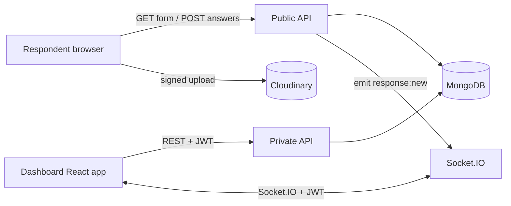

# QuickForm — Multi-Tenant Form Builder & Response Analytics

QuickForm lets organisations build custom forms, publish them as a shareable link, and watch responses arrive **live** on an analytics dashboard. Each organisation is an isolated tenant with its own team (owner, editors, viewers).

**Live demo:** https://quickform-1-sk1w.onrender.com  (API: https://quickform-ydqm.onrender.com/health). Hosted on Render's free tier with MongoDB Atlas, so the first load after idle can take about 30 seconds.

**Stack:** Node.js · Express · MongoDB (Mongoose) · Socket.IO · JWT · React (Vite) · Cloudinary · Render

## Features
- **Form builder** with 10 field types: short text, paragraph, email, number, dropdown, multiple choice, checkboxes, rating 1–5, date, file upload. Fields can be required and reordered.
- **Draft → published → closed** lifecycle. Publishing generates an unguessable public link (`/f/<slug>`), and closing stops new responses (HTTP 410).
- **Server-side answer validation.** Every public submission is checked against the form definition for type, required fields and allowed options. Unknown keys are dropped.
- **Real-time response tracking.** Dashboards join a Socket.IO room per form and update the moment a response arrives. The form list counters update live too.
- **Org-scoped analytics** computed with MongoDB aggregation pipelines: total, responses per day, option counts (checkbox arrays via `$unwind`), and rating/number averages.
- **CSV export** of all responses.
- **Cloudinary file uploads (signed, direct).** The browser uploads straight to Cloudinary using a signature our API issues. File bytes never pass through our server, and the API secret never leaves it.
- **JWT-secured RBAC:** owner, editor and viewer roles. Viewers see analytics but not raw responses.
- **Security:** bcrypt, helmet, CORS, rate limiting (stricter on public submission endpoints), express-validator, a central error handler.
- **Tested:** 18 integration tests (Jest, Supertest, in-memory MongoDB), including Socket.IO and tenant-isolation tests.

## Architecture



**Submission flow:** `POST /api/public/forms/:slug/responses` → load the published form → `validateAnswers(form, answers)` → save the Response → atomic `$inc` on `form.responseCount` → emit `response:new` to `form:<id>` and `form:count` to `org:<orgId>` → `201`.

## Data model

| Collection | Key fields | Notes |
|---|---|---|
| `organizations` | name | the tenant |
| `users` | orgId, name, email (unique), password (bcrypt), role | owner / editor / viewer |
| `forms` | orgId, createdBy, title, description, **fields[ ]**, status, **slug** (unique), responseCount | the form structure is stored as data: `{ key, label, type, required, options }` |
| `responses` | orgId, formId, **answers** (object keyed by field key), createdAt | index `{formId, createdAt}` |

**Why MongoDB here:** every form has a different shape, so responses are naturally schema-less. An `answers` object keyed by `field.key` stores any form without migrations. Field **keys** (not labels) are used so renaming a question doesn't break old responses.

## Roles

| | owner | editor | viewer |
|---|---|---|---|
| Create / edit / publish forms | ✅ | ✅ | — |
| See raw responses, export CSV | ✅ | ✅ | — |
| See analytics | ✅ | ✅ | ✅ |
| Delete forms, manage team | ✅ | — | — |

## API

| Method | Endpoint | Access |
|---|---|---|
| POST | `/api/auth/register` | public: creates the org and its owner |
| POST | `/api/auth/login` | public |
| GET / POST | `/api/users` | list: team · create: owner |
| GET / POST | `/api/forms` | list: team · create: owner, editor |
| GET / PUT / DELETE | `/api/forms/:id` | read: team · update: owner, editor · delete: owner |
| PATCH | `/api/forms/:id/status` | owner, editor |
| GET | `/api/forms/:id/responses` | owner, editor |
| GET | `/api/forms/:id/analytics` | team |
| GET | `/api/forms/:id/export.csv` | owner, editor |
| GET | `/api/public/forms/:slug` | public (published or closed forms only) |
| POST | `/api/public/forms/:slug/responses` | public, rate-limited |
| GET | `/api/public/forms/:slug/upload-signature` | public, rate-limited |

**Socket events:** client → `form:watch(formId, ack)` (the server checks the form belongs to your org before joining) · server → `response:new`, `form:count`

## Run locally
```bash
cd server && cp .env.example .env && npm install && npm run dev     # needs MongoDB (local or Atlas)
cd client && npm install && npm run dev                             # http://localhost:5173
cd server && npm test                                               # in-memory MongoDB, no setup
```
For file fields, add Cloudinary credentials to `server/.env`.

## Deploy (Render)
`render.yaml` is a Render Blueprint that creates **quickform-api** (Node web service) and **quickform-web** (static site with an SPA rewrite). Use MongoDB Atlas for `MONGO_URI`, and set `CLIENT_ORIGIN` and `VITE_API_URL` to each other's URLs. GitHub Actions runs the tests and the client build on every push.

## Project structure
```
server/src
  models/      Organization, User, Form, Response
  services/    answerValidator, analytics (aggregations), csv
  controllers/ auth, user, form, public
  routes/      route definitions + RBAC + validation
  socket/      JWT handshake, org/form rooms, form:watch authorisation
client/src
  pages/       Login, Register, Forms, Builder, Results (live dashboard), PublicForm, Team
```

## What I'd add next
- Conditional logic (show question B only if A = "Yes")
- Precomputed daily stats or a Redis cache for very high-volume forms
- reCAPTCHA or Turnstile on public forms, and duplicate-submission protection
- Webhooks so responses can be pushed to Slack, Sheets or a CRM
